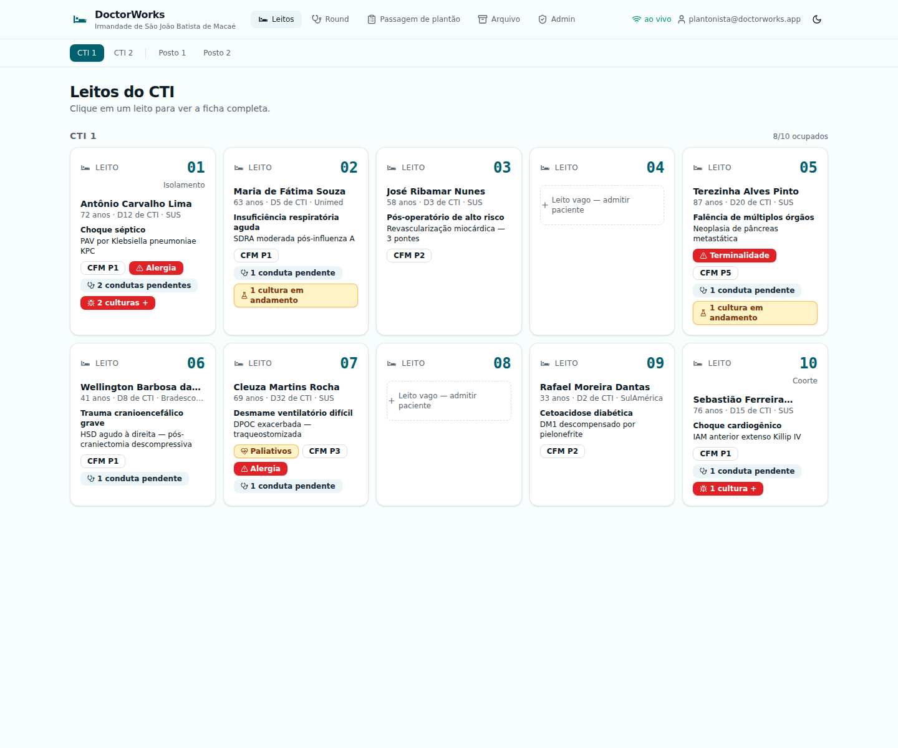

# passagemplant-o

Quadro de leitos de terapia intensiva — uma reprodução da tela
`/dashboard?unit=cti-1` do DoctorWorks, rodando de forma independente com um
conjunto de dados de demonstração.



## O que está aqui

- **`/dashboard?unit=<slug>`** — o quadro de leitos. Agrupa por unidade, mostra
  a contagem de ocupação, e cada card traz nome, idade, dia de internação,
  convênio, diagnóstico sindrômico e específico, além das tarjas de
  terminalidade, paliativos, prioridade CFM, alergia, condutas pendentes e
  culturas em andamento ou positivas.
- **`/leito/:bedNumber?unit=<slug>`** — a ficha do leito: condutas do round,
  invasões com contagem de dias, medicações em curso e culturas.
- **Unidades de CTI e de enfermaria.** O quadro muda de comportamento conforme
  o `kind` da unidade: enfermaria esconde leitos vagos e a prioridade CFM, e
  acrescenta as tarjas de visita do dia e de pareceres pendentes.
- **Tema claro e escuro**, com os mesmos tokens de cor da referência.

- **`/passagem?setor=<id>`** — a passagem de plantão. Escolhe-se o setor, os
  pacientes vêm direto do Viver (com as iniciais no lugar do nome) e a folha sai
  pronta para imprimir em A4 deitado. Atualiza sozinha a cada 5 minutos.

As seções Round, Arquivo e Admin existem na navegação mas não foram
implementadas.

## Passagem de plantão puxando do Vivver

O site é hospedado num servidor (guia para a TI em [HOSPEDAGEM.md](HOSPEDAGEM.md))
e cada pessoa usa pelo link, entrando com **o próprio usuário e senha do
Vivver** — nada é instalado nos computadores do hospital. O servidor abre uma
sessão de navegador para cada pessoa e lê os pacientes do setor com o acesso
dela. Senhas não são guardadas e não há banco de dados de pacientes.

Para desenvolver:

```bash
npm install
npm run viver:instalar-navegador
cp .env.example .env
npm run local            # site (5173) + servidor (5174)
```

Sem `VIVER_URL`, a tela mostra pacientes fictícios.

### Mapeando as telas do Vivver sem instalar nada

Com o Vivver aberto e logado, em cada tela: **F12 → Console → colar o conteúdo
de `server/explorar-navegador.js` → Enter**. Baixa `vivver-tela-N.html` com o
esqueleto da página e todos os textos embaralhados.

### Ensinando o robô a ler as telas do Viver

Onde fica cada informação no Viver está descrito num arquivo só,
`server/viver.config.mjs`. O endereço já vem apontando para o Vivver de Macaé
(`https://macae-rj.vivver.com/login`) e o setor padrão é o Politrauma 3 — os dois
se mudam no `.env`. Para descobrir isso sem expor dados de pacientes:

```bash
npm run viver:explorar
```

O Viver abre na tela; navegue até a lista de setores, a lista de pacientes e um
prontuário, apertando ENTER no terminal em cada uma. A estrutura de cada página
é salva em `server/exploracao/` com **todos os textos embaralhados** (letras
viram `x`, números viram `0`) — confira e compartilhe esses arquivos para
ajustar o `viver.config.mjs`.

Para ver o robô trabalhando, coloque `VIVER_MOSTRAR_NAVEGADOR=1` no `.env`.

## Rodando

```bash
npm install
npm run dev      # http://localhost:5173/dashboard?unit=cti-1
```

```bash
npm run build      # typecheck + bundle de produção
npm run typecheck  # só o typecheck
npm run preview    # serve o build
```

## Como o código está organizado

```
src/
  components/
    ui/            primitivas no padrão shadcn (card, badge, button, tooltip, skeleton)
    icons/         o ícone de leito hospitalar
    AppShell.tsx   cabeçalho, navegação e as abas de unidade
  data/
    types.ts       o modelo de dados
    demo.ts        o conjunto de dados semeado
    provider.ts    o lado de leitura do quadro
    queries.ts     os hooks de TanStack Query
    useUnit.ts     leitura e escrita do `?unit=` da URL
  lib/
    days.ts        contagem de dias, idade e formatação em pt-BR
    clinical.ts    prioridades CFM, invasões, medicações, culturas, antibiograma
  routes/          Dashboard, BedDetail e os placeholders
```

Duas regras de contagem valem a pena destacar, porque não são óbvias:

- **Dia de internação.** O dia da admissão é D1, não D0 — `daysSince()` soma 1.
  A data `YYYY-MM-DD` é lida como data local, para que a contagem não escorregue
  um dia em fusos a oeste de UTC.
- **Dia de antibiótico.** Um antibiótico começado hoje só conta como D1 amanhã,
  a menos que o esquema seja de dose única diária — marcado com `[1x/dia]` no
  campo `note`. É o que `therapyDayNumber()` faz.

## Ligando a um banco real

O quadro lê por `src/data/provider.ts`, que hoje devolve o conjunto semeado. Um
backend real entra substituindo as funções desse módulo; nenhum componente
precisa mudar, porque todos passam pelos hooks em `queries.ts`.

`supabase/schema.sql` descreve as tabelas que o quadro espera — `units`, `beds`,
`patients` (com a view `patients_public`), `conducts`, `cultures`, `invasions`,
`medications`, `ward_visits` e `consults` — junto com os índices que sustentam
as consultas de agregação do card.

Com Supabase, cada função do provider vira uma consulta direta. Por exemplo:

```ts
export async function fetchOpenConducts() {
  const { data, error } = await supabase
    .from("conducts")
    .select("patient_id, text")
    .eq("done", false)
    .is("deleted_at", null);
  if (error) throw error;
  // ...agrupa por patient_id como na versão de demonstração
}
```

Para atualização ao vivo, um canal de realtime por tabela (`patients`,
`conducts`, `cultures`, `ward_visits`, `consults`) que chame `refetch()` na
query correspondente reproduz o comportamento do indicador "ao vivo" do
cabeçalho, que nesta cópia é estático.

## Dados

Os pacientes semeados em `src/data/demo.ts` são fictícios e existem para
exercitar todos os estados do card. As datas de admissão são relativas a hoje,
então as contagens de dias continuam plausíveis com o tempo.

## Sobre a referência

O layout, os tokens de cor, o vocabulário clínico (escala de prioridade CFM,
tipos de invasão, classes de medicação, materiais de cultura) e as regras de
contagem de dias vêm do build público do DoctorWorks. Os textos e ícones foram
reescritos a partir dele; a marca e o logotipo do hospital não foram copiados —
o cabeçalho usa o próprio ícone de leito do projeto.
